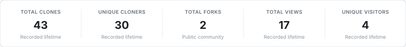
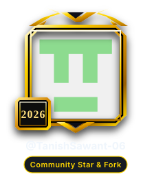
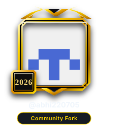
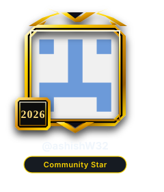

# Ethical Hacking and Forensics

Practical solutions, lab experiments, and reference implementations for Semester 5 Ethical Hacking and Forensics.

<!-- REPOSITORY_ANALYTICS_START -->
### Repository Insights

<p align="center">
  
</p>
<br><br>

<p align="center">
  
</p>

<p align="center">
  
</p>

<table align="center" border="0" style="border: none; border-collapse: collapse;">
  <tr>
    <td align="center" style="border: none; padding: 12px 20px;">
      <a href="https://github.com/TanishSawant-06">
        
      </a>
    </td>
    <td align="center" style="border: none; padding: 12px 20px;">
      <a href="https://github.com/abhi220705">
        
      </a>
    </td>
    <td align="center" style="border: none; padding: 12px 20px;">
      <a href="https://github.com/AshishWaghmare12">
        
      </a>
    </td>
    <td align="center" style="border: none; padding: 12px 20px;">
      <a href="https://github.com/ashishW32">
        
      </a>
    </td>
  </tr>
</table>
<!-- REPOSITORY_ANALYTICS_END -->

---

### Support & Contribute

If this repository helps your studies, practicals, or reference work, support the project:

<p align="left">
  <a href="https://github.com/shivampimple29/Ethical-Hacking-and-Forensics-sem5/stargazers">
    
  </a>
  &nbsp;&nbsp;
  <a href="https://github.com/shivampimple29/Ethical-Hacking-and-Forensics-sem5/fork">
    
  </a>
  &nbsp;&nbsp;
  <a href="https://github.com/shivampimple29">
    
  </a>
  &nbsp;&nbsp;
  <a href="https://github.com/shivampimple29/Ethical-Hacking-and-Forensics-sem5/issues">
    
  </a>
</p>

```bash
# Clone this repository
git clone https://github.com/shivampimple29/Ethical-Hacking-and-Forensics-sem5.git
```
